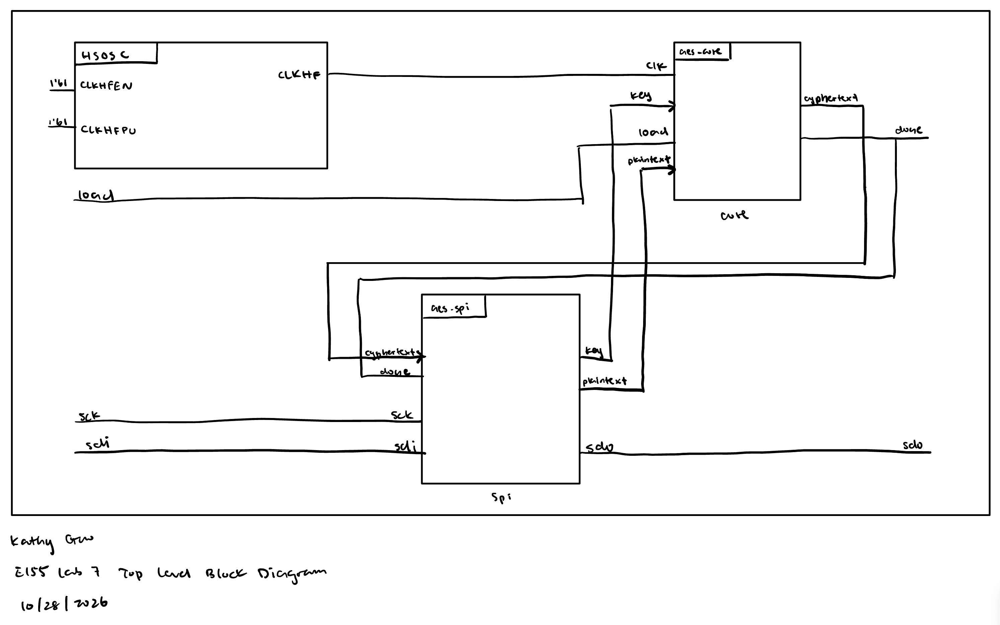
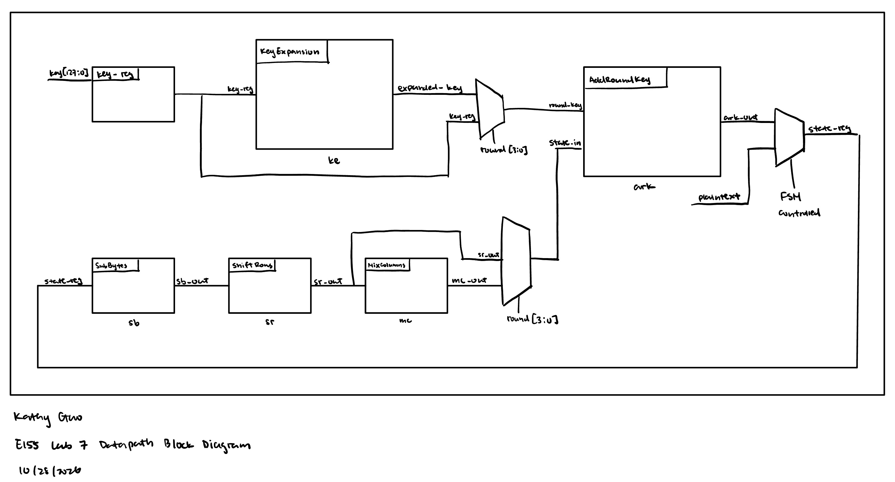
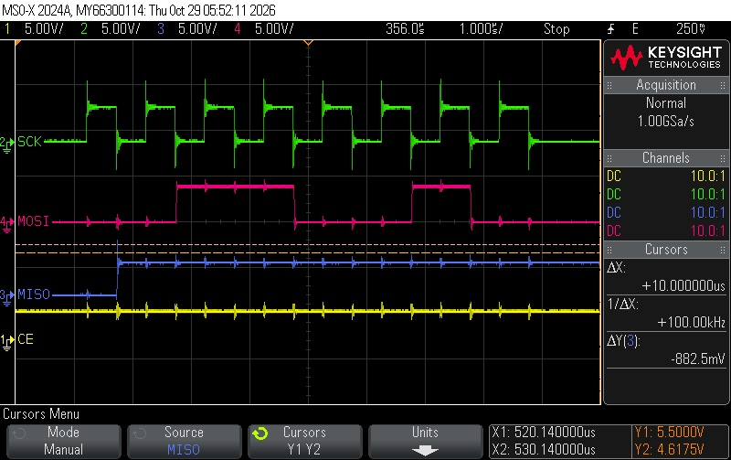
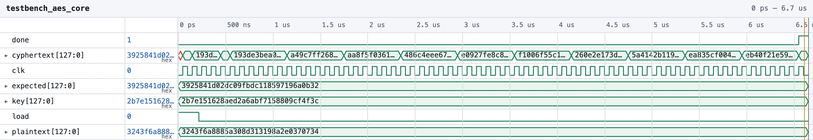
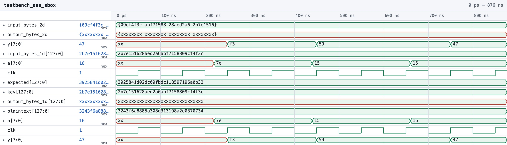
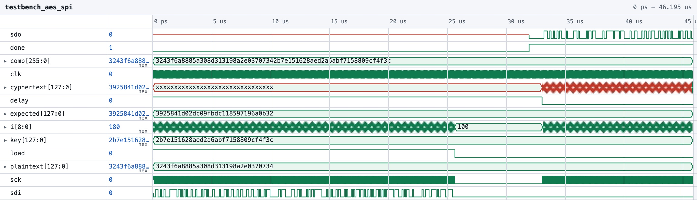

# Introduction
In this lab, SystemVerilog code was written to implement a 128-bit AES encryption and decryption module on an FPGA. Then, the FPGA communicates with a MCU via SPI to receive clock, plaintext data, encrypt it, and send the ciphertext back to the MCU. If AES encryption is sucessful, the program will light up PA9 on the E155 PCB.

# Design and Testing Methodology
The main module of the AES implementation is the `aes` module, which instantiates a high-speed on-board oscillation `HSOCS`, the `aes_core` module, and the `aes-spi` module. The `aes_core` module implements the AES algorithm by calling the appropriate functions, including `AddRoundKey`, `SubBytes`, `ShiftRows`, `KeyExpansion`, and `MixColumns`. The `aes_spi` module handles the SPI communication with the MCU and provides a simple interface for sending and receiving data. The `aes_core` module includes a state machine that controls the flow of data between the different stages of the AES algorithm.

# Technical Documentation
The source code for the project can be found in the associated [Github repository](https://github.com/kathy-guo811/e155-lab7).

### Block Diagram

::: {.callout-note appearance="simple" title="Expand to see Lab 7 Block Diagram" icon=false collapse="true"}



Figure 1 shows the how the system block diagram is laid out. The MCU communicates with the FPGA via SPI, and the FPGA implements the AES algorithm to encrypt and decrypt data. The FPGA also controls the on-board oscillation and provides a simple interface for sending and receiving data.



Figure 2 shows the data path of the AES implementation. 

:::

### SPI Communication Waveform

::: {.callout-note appearance="simple" title="Expand to see Lab 7 SPI Communication Waveform" icon=false collapse="true"}



Figure 3 shows the first encryption cycle of the SPI communication waveform between the MCU and the FPGA. MISO is the Master In Slave Out line, which is used to send data from the FPGA to the MCU, while MOSI is the Master Out Slave In line, which is used to send data from the MCU to the FPGA. SCK is the Serial Clock line, which is used to synchronize the data transfer between the MCU and the FPGA.

For the first cycle, the FPGA is supposed to receive first byte of the plaintext data from the MCU, which is 0x32. From the waveform, notice  SCK syncs MOSI and MISO, MISO is actively high, and MOSI reads data by going high; MISO reads 00110010 for the first cycle, which is 0x32 in hexadecimal. 
:::

### Testbench Simulation
::: {.callout-note appearance="simple" title="Expand to see Lab 7 Simulation Results" icon=false collapse="true"}









The design met all intended design objectives. The above figures show screenshots of the QuestaSim simulation waveforms for the `aes_core`, `aes_sbox`, and `aes_spi` modules. 

The `aes_core` module was tested with a plaintext input and a key input, and the output was compared to the expected ciphertext output. Once `done` is high on the simulation, the expected ciphertext output is generated, showing that the `aes_core` module correctly implements the AES algorithm and produces the expected ciphertext output.

The `aes_sbox` module was tested with various input values, and the output was compared to the expected output for each input. The simulation shows that the `aes_sbox` module correctly implements the S-box substitution.

The `aes_spi` module also was tested with various input values, and the output was compared to the expected output for each input. The simulation shows that the `aes_spi` module correctly implements the SPI communication protocol and produces the expected output.

# Conclusion 

The design successfully implemented a 128-bit AES encryption and decryption module on an FPGA, which communicates with a MCU via SPI. The design met all intended design objectives, and the testbench simulations confirmed that the modules correctly implement the AES algorithm and SPI communication protocol. 
<!--  -->
# AI Prototype Summary

::: {.callout-note appearance="simple" title="Expand to see SystemVerilog code generated by Gemini" icon=false collapse="true"}

```
// Part 1 of AI Prototype 
module key_expansion (
    input  logic [128:0-1] prev_key,   // 128-bit key from the previous round (w[i-4]..w[i-1])
    input  logic [3:0]     round_num,  // Current round index (1 to 10)
    output logic [127:0]   next_key    // 128-bit key for the next round (w[i]..w[i+3])
);

    // Round constant lookup table (Rcon[j], where j = round_num)
    // AES uses Rcon[1] through Rcon[10] for round keys 1 to 10.
    logic [31:0] rcon;
    always_comb begin
        case (round_num)
            4'd1:  rcon = 32'h01_00_00_00;
            4'd2:  rcon = 32'h02_00_00_00;
            4'd3:  rcon = 32'h04_00_00_00;
            4'd4:  rcon = 32'h08_00_00_00;
            4'd5:  rcon = 32'h10_00_00_00;
            4'd6:  rcon = 32'h20_00_00_00;
            4'd7:  rcon = 32'h40_00_00_00;
            4'd8:  rcon = 32'h80_00_00_00;
            4'd9:  rcon = 32'h1B_00_00_00;
            4'd10: rcon = 32'h36_00_00_00;
            default: rcon = 32'h00_00_00_00;
        endcase
    end

    // Split the previous key into four 32-bit words[cite: 10]:
    // prev_key = { w_prev3, w_prev2, w_prev1, w_prev0 }
    logic [31:0] w_prev0, w_prev1, w_prev2, w_prev3;
    assign {w_prev0, w_prev1, w_prev2, w_prev3} = prev_key;

    // Apply RotWord and SubWord to w_prev3
    logic [31:0] rot_word_out;
    logic [31:0] sub_word_out;

    // RotWord: Cyclic byte shift to the left[cite: 25]
    rot_word u_rot_word (
        .in  (w_prev3),
        .out (rot_word_out)
    );

    // SubWord: Applies S-box substitution to each byte[cite: 25]
    sub_word u_sub_word (
        .in  (rot_word_out),
        .out (sub_word_out)
    );

    // Generate the next four 32-bit words according to FIPS-197 Algorithm 2[cite: 25, 26]:
    // w[i]   = w[i-4] ^ SubWord(RotWord(w[i-1])) ^ Rcon[i/4]
    // w[i+1] = w[i-3] ^ w[i]
    // w[i+2] = w[i-2] ^ w[i+1]
    // w[i+3] = w[i-1] ^ w[i+2]
    logic [31:0] w_next0, w_next1, w_next2, w_next3;

    always_comb begin
        w_next0 = w_prev0 ^ sub_word_out ^ rcon;
        w_next1 = w_prev1 ^ w_next0;
        w_next2 = w_prev2 ^ w_next1;
        w_next3 = w_prev3 ^ w_next2;
    end

    // Concatenate the words to output the next round key
    assign next_key = {w_next0, w_next1, w_next2, w_next3};

endmodule

// Part 2 of AI Prototype
module module1 (
    input  logic [31:0] in,
    output logic [31:0] out
);
    // Implementation
endmodule

module module2 (
    input  logic [31:0] in,
    output logic [31:0] out
);
    // Implementation
endmodule

module key_expansion #(
    parameter int Nk = 4,              // Key length in 32-bit words (e.g., 4, 6, or 8)
    parameter int Nr = 10,             // Number of rounds
    parameter int NUM_WORDS = 4*Nr + 4 // Total words w[0] to w[4*Nr+3]
)(
    input  logic [32*Nk-1:0] key,                   // Full input key
    input  logic [31:0]      Rcon [1:NUM_WORDS/Nk], // Rcon lookup table (1-indexed for i/Nk)
    output logic [31:0]      w    [0:NUM_WORDS-1]   // Expanded key array
);

    // =========================================================================
    // Initial Key Words (i = 0 to Nk-1)
    // =========================================================================
    // w[i] <- key[4*i..4*i+3] (4-byte chunks concatenated into 32-bit words)
    genvar i;
    generate
        for (i = 0; i < Nk; i++) begin : gen_initial_words
            assign w[i] = key[32*(Nk - i) - 1 -: 32];
        end
    endgenerate

    // =========================================================================
    // Main Key Expansion Loop (i = Nk to 4*Nr + 3)
    // =========================================================================
    generate
        for (i = Nk; i < NUM_WORDS; i++) begin : gen_expansion_words

            logic [31:0] temp_in;
            logic [31:0] temp_out;

            // Previous iteration word w[i-1]
            assign temp_in = w[i-1];

            // Conditional branch logic based on i mod Nk
            if (i % Nk == 0) begin : gen_mod0
                logic [31:0] mod2_out;
                logic [31:0] mod1_out;

                // Instantiate module2(temp)
                module2 u_module2 (
                    .in  (temp_in),
                    .out (mod2_out)
                );

                // Instantiate module1(module2(temp))
                module1 u_module1 (
                    .in  (mod2_out),
                    .out (mod1_out)
                );

                // XOR with Rcon[i/Nk]
                assign temp_out = mod1_out ^ Rcon[i / Nk];

            end else if (Nk > 6 && (i % Nk == 4)) begin : gen_mod4
                logic [31:0] mod1_out;

                // Instantiate module1(temp)
                module1 u_module1 (
                    .in  (temp_in),
                    .out (mod1_out)
                );

                assign temp_out = mod1_out;

            end else begin : gen_pass_through
                // Default case: temp remains unchanged
                assign temp_out = temp_in;
            end

            // w[i] <- w[i-Nk] (+) temp
            assign w[i] = w[i-Nk] ^ temp_out;

        end
    endgenerate

endmodule
```

:::

Neither LLM-generated was able to synthesize because both were missing submodules

I noticed witholding the spec forces the LLM to guess the microarchitecture and interfaces. Instead of functional hardware, it outputs syntactically formatted pseudo-code that fails to synthesize and cannot integrate into a real chip design.